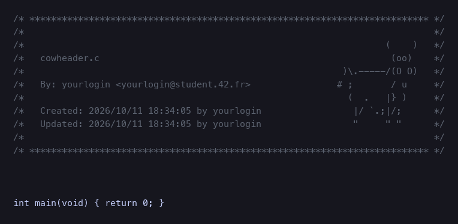

# cowheader

The classic 42 coding-school header, now with a cow. Renamed fork of
[42paris/42header](https://github.com/42paris/42header).



## What it does

- Inserts an 11-line header: filename, author, mail, creation and update timestamps.
- ASCII art on the right: `43` by default, or the `cow` above.
- Refreshes the `Updated:` line on every save.
- Repairs merge conflicts that land inside the header when the file opens.
- Comment tokens adapt to the filetype: C, C++, Go, Rust, Java, PHP, JS/TS, Lua, Vim, Python, Fortran, and more.

## Install

With [lazy.nvim](https://github.com/folke/lazy.nvim):

```lua
{
  "42pro/cowheader",
  main = "42header",
  opts = { user = "yourlogin", mail = "you@example.com", art = "cow" },
}
```

Plain Vim or Neovim: copy `plugin/stdheader.vim` into `~/.vim/plugin/` (or
`~/.config/nvim/plugin/`) and set the variables in your vimrc:

```vim
let g:user42 = 'yourlogin'
let g:mail42 = 'yourlogin@student.42.fr'
let g:header_art = 'cow'   " optional: '43' (default) or 'cow'
```

## Configuration

| lazy `opts` | vim global     | meaning                     | fallback |
| ----------- | -------------- | --------------------------- | -------- |
| `user`      | `g:user42`     | login shown in the header   | `$USER`  |
| `mail`      | `g:mail42`     | mail shown in the header    | `$MAIL`  |
| `art`       | `g:header_art` | `"43"` or `"cow"`           | `"43"`   |

`opts` wins over globals set elsewhere; unknown `art` values raise an error.

## Usage

In normal mode: `:Stdheader` or `F1`. Running it on a file that already has a
header only refreshes the filename and the `Updated:` line.

## Credits

Built on [42paris/42header](https://github.com/42paris/42header) by
[@zazard](https://github.com/zazard) and contributors:
[@alexandregv](https://github.com/alexandregv),
[@mjacq42](https://github.com/mjacq42),
[@sungmcho](https://github.com/lordtomi0325),
[@fclivaz42](https://github.com/fclivaz42),
[@0xmthan](https://github.com/0xmthan).

## License

This work is published under the terms of the
[42 Unlicense](https://github.com/gcamerli/42unlicense).
